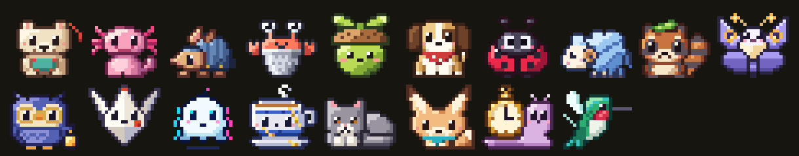
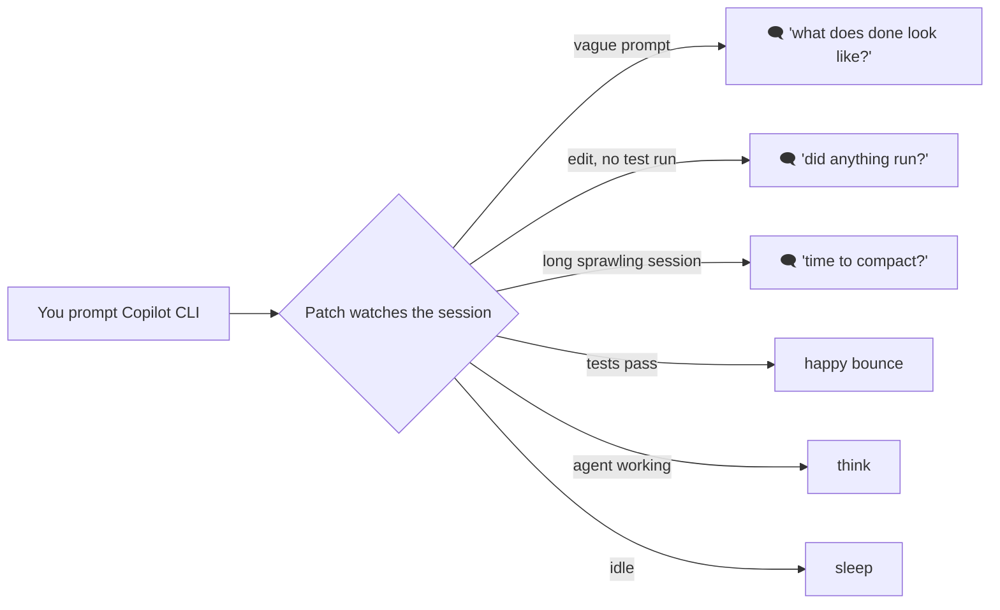
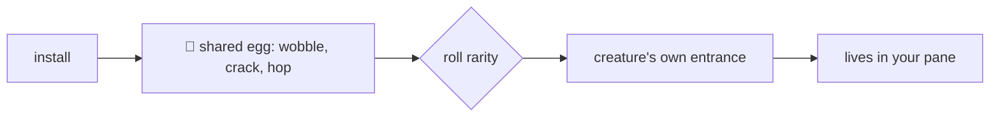
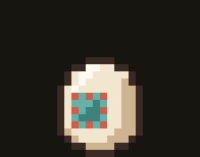

# hatchwork

**Patch is a tiny pixel creature that lives next to your GitHub Copilot CLI prompt and coaches you into being a better agentic engineer.**
Every install hatches a different one.

<p align="center">
  
</p>

<p align="center">
  
</p>

---

## Why Patch exists

Working with a coding agent is a skill. The people who get the most out of it:

| Habit | What it looks like | Who says it |
|---|---|---|
| **Specific prompts** | names the target, constraints, and what done looks like | Pon: *"say what it should become, not just what to change."* |
| **Verification** | runs the tests before trusting the diff | Rivet: *"looks right. run the tests before we call it done."* |
| **Context hygiene** | keeps sessions focused, leaves out what isn't needed | Thimble: *"that file is not needed here. leave it out."* |
| **Planning first** | splits work into steps before generating code | Fold: *"measure twice, fold once. what are the steps?"* |
| **Calibrated autonomy** | knows when to let the agent run and when to steer | Byte: *"scoped and reversible? let it run. otherwise, hold the leash."* |
| **Reading before merging** | reviews the whole diff, not the summary | Lumen: *"read the diff before you merge. all of it."* |
| **Recovery** | reads the error, changes one thing, retries | Axo: *"that failed. read the error, change one thing, run again."* |

Most of this is learned the slow way. Patch watches the session from a side pane and says one short thing at the right moment, instead of a wall of tips nobody reads.



Each creature has moods (`idle`, `blink`, `talk`, `think`, `happy`, `sleep`, `fidget`) so it reacts to what's happening without a word.

## The hatch

On first run you get **one creature at random**. Every egg wobbles and cracks the same way, so you can't tell what's inside. Then each creature has **its own way out**.



| Rarity | Chance | |
|---|---|---|
| ★ common | 55% | the everyday mentors |
| ★★ uncommon | 28% | specialists |
| ★★★ rare | 13% | deeper habits |
| ★★★★ legendary | 4% | the most elaborate hatches |

Each creature specializes in one habit, but all of them coach the whole set.

## The dex

<!-- count -->18<!-- /count --> creatures so far. Every GIF below is rendered from the creature's source file by `scripts/media.py`: shared egg, its own entrance, then a few seconds of its idle life.

<!-- dex:start -->
<table>
<tr><td></td><td><b>#001 Patch</b><br><sub>felt plush cub</sub><br>★ common · 6.1%</td><td><b>Coaches:</b> An all-rounder mentor that nudges you on prompting, delegation, verification and context, one small habit at a time.<br><br><i>“say what done looks like before you start.”</i><br><br><sub><b>Hatch:</b> The teal patch on the egg peels open like a pocket, Patch climbs out, shakes off, and the patch ends up sewn on its belly.</sub></td></tr>
<tr><td></td><td><b>#002 Axo</b><br><sub>pond axolotl sprite</sub><br>★★ uncommon · 5.6%</td><td><b>Coaches:</b> Iterating after failure: read the error, change one thing, retry smarter.<br><br><i>“that failed. read the error, change one thing, run again.”</i><br><br><sub><b>Hatch:</b> Water seeps from the crack and Axo floats out in a bubble that pops.</sub></td></tr>
<tr><td></td><td><b>#003 Rivet</b><br><sub>riveted armadillo</sub><br>★ common · 6.1%</td><td><b>Coaches:</b> Verification and tests: run the suite, read the output, then say done.<br><br><i>“looks right. run the tests before we call it done.”</i><br><br><sub><b>Hatch:</b> An armored ball bursts out, rolls across, bounces back, wobbles, and pops open.</sub></td></tr>
<tr><td></td><td><b>#004 Thimble</b><br><sub>thimble hermit crab</sub><br>★ common · 6.1%</td><td><b>Coaches:</b> Context hygiene: carry only what the task needs; drop the rest.<br><br><i>“that file is not needed here. leave it out.”</i><br><br><sub><b>Hatch:</b> The egg top pops off; a thimble inside sprouts claws and periscope eyes.</sub></td></tr>
<tr><td></td><td><b>#005 Sprig</b><br><sub>acorn-capped pea sprite</sub><br>★ common · 6.1%</td><td><b>Coaches:</b> Decomposition: break the work into small steps and finish them in order.<br><br><i>“smaller step. do the first piece, then the next.”</i><br><br><sub><b>Hatch:</b> The egg sinks into soil; a sprout pokes up, grows, and Sprig pops out.</sub></td></tr>
<tr><td></td><td><b>#006 Scout</b><br><sub>bandana puppy</sub><br>★ common · 6.1%</td><td><b>Coaches:</b> Research before acting: read the code and docs, then make the change.<br><br><i>“let me sniff around the codebase before we dig in.”</i><br><br><sub><b>Hatch:</b> The egg rocks on stubby paws, a tail wags out, and it bursts free wearing the shell as a hat.</sub></td></tr>
<tr><td></td><td><b>#007 Dotty</b><br><sub>bug-hunting ladybug</sub><br>★ common · 6.1%</td><td><b>Coaches:</b> Debugging: reproduce the bug first, then fix it.<br><br><i>“let's make it happen again before we fix it.”</i><br><br><sub><b>Hatch:</b> The egg buzzes, pops its lid, and Dotty zips up on blurry wings before tucking them away.</sub></td></tr>
<tr><td></td><td><b>#008 Skein</b><br><sub>yarn-wool sheep</sub><br>★ common · 6.1%</td><td><b>Coaches:</b> Long sessions: notice when context has tangled, summarize, and /compact before it knots.<br><br><i>“this thread is getting long. want to wind it up?”</i><br><br><sub><b>Hatch:</b> A strand of yarn unspools from the crack, the egg unravels into a ball, and the ball fluffs up into Skein.</sub></td></tr>
<tr><td></td><td><b>#009 Pon</b><br><sub>leaf-cap tanuki</sub><br>★★ uncommon · 5.6%</td><td><b>Coaches:</b> Prompt specificity: name the target, the constraints, and what done looks like.<br><br><i>“say what it should become, not just what to change.”</i><br><br><sub><b>Hatch:</b> The egg vanishes in a puff of smoke, a leaf flutters down, and Pon is standing there mid-pose.</sub></td></tr>
<tr><td></td><td><b>#010 Wick</b><br><sub>dusk moth</sub><br>★★ uncommon · 5.6%</td><td><b>Coaches:</b> Before building, look for the gaps: missing acceptance criteria, unstated edge cases, undefined done.<br><br><i>“something here is still unlit. what counts as done?”</i><br><br><sub><b>Hatch:</b> The crack glows like a lamp, the shell softens into a silk cocoon, and Wick unfolds its wings.</sub></td></tr>
<tr><td></td><td><b>#011 Lumen</b><br><sub>lantern owl scholar</sub><br>★★★ rare · 4.3%</td><td><b>Coaches:</b> Reviewing diffs: read what the agent changed, line by line, before you merge.<br><br><i>“read the diff before you merge. all of it.”</i><br><br><sub><b>Hatch:</b> Night falls, the egg glows like a lantern, and its lid lifts as Lumen flaps out.</sub></td></tr>
<tr><td></td><td><b>#012 Fold</b><br><sub>origami crane</sub><br>★★★ rare · 4.3%</td><td><b>Coaches:</b> Plans before cutting code: sketches the steps, names the creases (interfaces, edge cases, order of work), and only then lets you fold.<br><br><i>“measure twice, fold once. what are the steps?”</i><br><br><sub><b>Hatch:</b> The egg flattens into a square sheet, then folds step by step — square, triangle, kite, crane — each crease flashing as it lands.</sub></td></tr>
<tr><td></td><td><b>#013 Byte</b><br><sub>glitch ghost</sub><br>★★★ rare · 4.3%</td><td><b>Coaches:</b> Calibrating autonomy: let the agent run on well-scoped, reversible work; keep a hand on it for anything risky or vague.<br><br><i>“scoped and reversible? let it run. otherwise, hold the leash.”</i><br><br><sub><b>Hatch:</b> The egg dissolves into static, scanlines sweep, and Byte snaps into focus as its colors converge.</sub></td></tr>
<tr><td></td><td><b>#014 Tsugi</b><br><sub>kintsugi teacup spirit</sub><br>★★★★ legendary · 4.0%</td><td><b>Coaches:</b> Turns mistakes into lessons: asks what broke, what the fix taught you, and what to write down so the repair makes you stronger.<br><br><i>“that bug is a seam now. what did it teach you?”</i><br><br><sub><b>Hatch:</b> The egg shatters outward, the pieces hang in the air, drift back and reform as a teacup, gold traces every crack, steam rises, and Tsugi opens its eyes.</sub></td></tr>
<tr><td></td><td><b>#015 Mochi</b><br><sub>loaf-shaped smoke cat</sub><br>★ common · 6.1%</td><td><b>Coaches:</b> Knowing when to stop: take a break, wrap up, start a fresh session.<br><br><i>“good place to stop. save it and start fresh.”</i><br><br><sub><b>Hatch:</b> The egg bottom becomes a little box; Mochi climbs in, turns once, and loafs.</sub></td></tr>
<tr><td></td><td><b>#016 Hush</b><br><sub>big-eared fennec kit</sub><br>★ common · 6.1%</td><td><b>Coaches:</b> Asking clarifying questions: listen fully, confirm the goal, then act.<br><br><i>“before we start: what does done look like here?”</i><br><br><sub><b>Hatch:</b> Two huge ears poke out of the crack and listen; then the egg falls away.</sub></td></tr>
<tr><td></td><td><b>#017 Tock</b><br><sub>pocket-watch snail</sub><br>★★ uncommon · 5.6%</td><td><b>Coaches:</b> Performance and patience: measure before you optimize, then measure again after.<br><br><i>“time it first. then we will know what is slow.”</i><br><br><sub><b>Hatch:</b> The egg cracks, rewinds itself whole, cracks again, rolls into a pocket watch, and Tock slides out.</sub></td></tr>
<tr><td></td><td><b>#018 Zip</b><br><sub>hummingbird</sub><br>★★ uncommon · 5.6%</td><td><b>Coaches:</b> Tight feedback loops: make the smallest change, run it, look, and go again.<br><br><i>“small change. run it. again. faster.”</i><br><br><sub><b>Hatch:</b> Something green streaks past until the egg spins, then the top pops off and Zip is already hovering.</sub></td></tr>
</table>
<!-- dex:end -->

## Try it

No dependencies, no build.

```sh
open dex.html                    # the gallery: every sprite, mood, and entrance; hatch an egg
node cli.js pon                  # print a creature in your terminal (truecolor half-blocks)
node cli.js tsugi --entrance     # play a hatch in your terminal
node cli.js --all                # everyone, idle
node cli.js --check              # validate every creature (exit 1 on errors)
```

The dex has a **hatch an egg** button (weighted random, same odds as above), ★ to keep favorites, and `dex.html?only=<id>&sheet=1` for a review sheet with every sprite at 12× and every entrance frame at 5×.

## How the sprites are made

Each creature is pixel art drawn as strings, one character per pixel, in its own file under [`creatures/`](creatures).

```js
const idle = [
  '.........GG...........',
  '..oo..GGhhgGoo........',
  '.okkGghgggGokko.......',
  // ...
];
PatchDex.register({ id: 'pon', name: 'Pon', rarity: 'uncommon', palette: { o: '#3d1f1c', ... },
  sprites: { idle, blink, talk, happy, sleep, think, fidget }, entrance: k => [...k.eggIntro(), ...] });
```

In a terminal, every cell becomes a `▀` half-block with a truecolor foreground (top pixel) and background (bottom pixel), so a 22×20 sprite fits in 22 columns × 10 rows and pixels stay square. This is the same technique as `pokemon-colorscripts`.

```
 one terminal cell        ▀   fg = top pixel
 = two stacked pixels         bg = bottom pixel
```

Sprites are at most 22×20 pixels and are hand-placed, with outlines, top-left lighting and 3 to 4 shades per material. Entrances play on a 28×22 stage and always start with the shared egg (`k.eggIntro()`). The kit in [`core.js`](core.js) gives `k.at`, `k.over`, `k.egg`, `k.stamp`, `k.sparkle` and the egg's crack/shell pieces to build on.

### Add a creature

1. Copy [`creatures/_template.js`](creatures/_template.js) to `creatures/<id>.js` and add the id to [`roster.js`](roster.js).
2. Draw `idle` first; open `dex.html?only=<id>&sheet=1` (or `./scripts/shot.sh <id>` for a headless screenshot) and iterate until the silhouette reads at actual size.
3. Add moods and an entrance. `node cli.js --check` must pass.
4. `python3 scripts/media.py` regenerates the GIFs and this README's dex table.

Bar for new creatures: original (no Pokémon, Digimon or Claude Code buddy lookalikes), readable at 1×, every mood distinguishable at actual size, and an entrance that tells you who it is before it's fully out of the egg.

## Layout

```
core.js            renderer, shared egg, entrance kit, validation, rarity roll, ANSI output
dex.html           the gallery
cli.js             terminal renderer and validator
roster.js          creature order
creatures/         one file per creature
scripts/media.py   renders docs/media/* and the dex table above (needs Pillow)
scripts/dump.js    creatures → JSON for media.py
scripts/shot.sh    headless Chrome screenshot of a creature's review sheet
```

## Status

The hatchery (art, moods, entrances, rarity, gallery, terminal renderer) is working. Not here yet:

- the Copilot CLI integration that watches a session and picks moods and lines
- an installer that hatches on first run and remembers your creature
- more creatures; another wave is being drawn
