# hatchwork

**Patchlings are tiny pixel creatures that live next to your GitHub Copilot CLI prompt and coach you into being a better agentic engineer.**
Every install hatches a different one, and yours **evolves** as you get measurably better at working with agents.

<p align="center">
  
</p>

<p align="center">
  
</p>

<p align="center">
  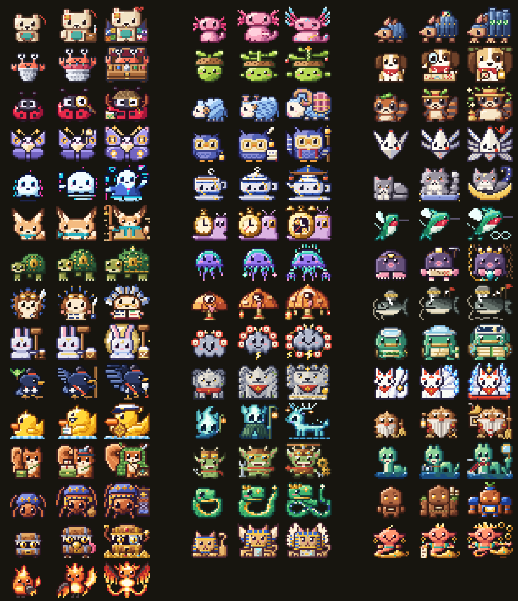
</p>

---

## Install with Copilot CLI

In Copilot CLI, say:

```
install and set up https://github.com/sophiagavrila/hatchwork
```

The agent clones the repo and runs [`install.sh`](install.sh) (instructions for it are in [`AGENTS.md`](AGENTS.md)). That opens the **sensei ceremony** in a tmux popup or a new terminal window. By hand: `gh repo clone sophiagavrila/hatchwork && ./hatchwork/install.sh`.

### The ceremony

<p align="center">
  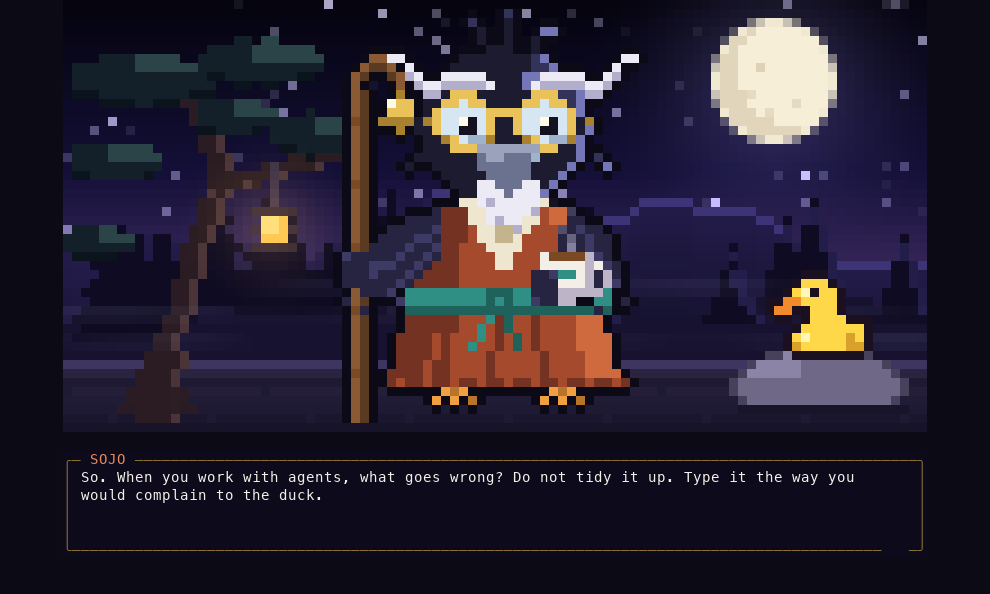
</p>

It is 3:07 a.m. somewhere above the cloud provider. A bell, a slurp of tea, too much smoke, and **Sojo** steps out of it coughing: a retired crow in spectacles with a staff, a rust robe, and a chipped mug. He hoards good commit messages. A rubber duck sits on a rock nearby and has heard it all before. He asks one question:

> *So. When you work with agents, what goes wrong? Do not tidy it up. Type it the way you would complain to the duck.*

Type whatever comes to mind, as much as you want. Sojo quotes your words back to you, names what he hears, and gives you a saying ("“Works on my machine” is not proof. It is a confession.") and a **path** (one of the eight habits, or the Way of the Whole Craft if you're losing your own skills). He rings his bell and the light becomes an egg the color of that path. Mostly egg. He does not stay for the hatch; the robe is dry-clean only.

Then it is you, the egg, and the duck. The egg wobbles. Nothing happens. You tap it (space or enter) and it cracks, leaks light, goes quiet long enough to worry the duck, and bursts. *Who's that Patchling?!* A silhouette, a star-by-star rarity drumroll, then the color floods in: the **Patchling matched to what goes wrong for you**, with its first lesson.

<p align="center">
  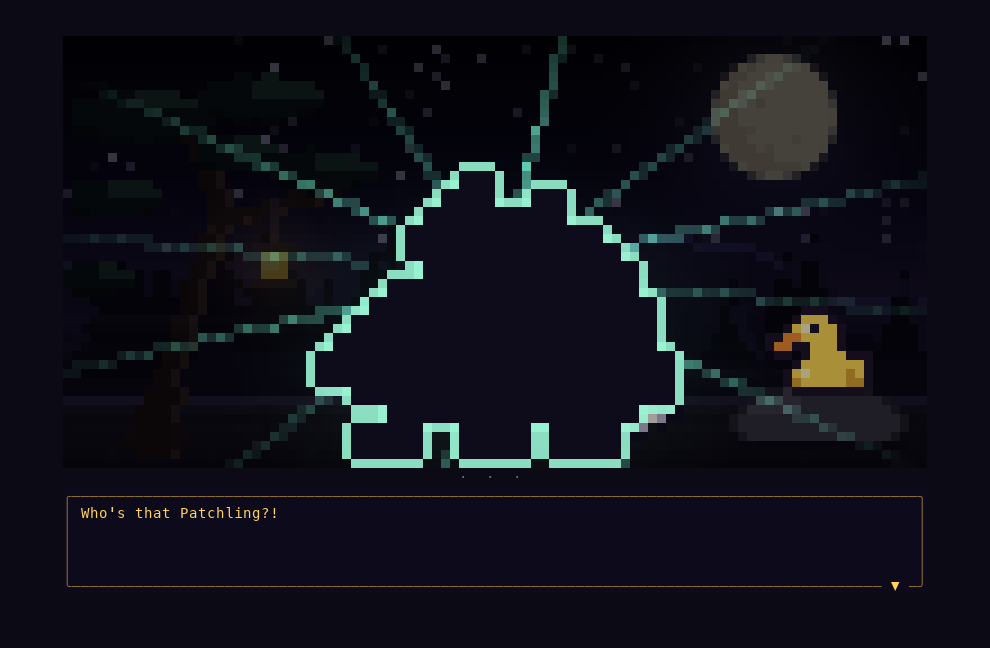
</p>

| You say something like | Path | You might hatch |
|---|---|---|
| "it says done but never runs the tests" | the Way of the Green Check (verification) | Rivet, Dotty |
| "long sessions it forgets my instructions" | the Way of the Clean Window (context) | Skein, Thimble, Loam |
| "we go in circles on the same error" | the Way of the Graceful Retreat (recovery) | Ouro, Don |
| "I merge without reading the diff" | the Path of the Second Look (review) | Lumen |
| "I run five agents and they step on each other" | the Way of the Short Leash (autonomy) | Byte, Tosk |
| "I feel like I'm losing my own skills" | the Way of the Whole Craft | Kuro, Sojo's own student |

The reading is deterministic (same words, same egg) and runs locally: no model calls, nothing leaves your machine. The answer is stored with your Patchling in `~/.hatchwork/state.json`.

```sh
./install.sh                                   # install + ceremony (agents: opens a window and waits)
node sensei.js                                 # the ceremony, in a terminal of 96×31 or larger
node sensei.js --dry-run                       # watch it without saving
node sensei.js --fast                          # 2.5× speed (or HATCHWORK_SPEED=1.5)
node sensei.js --plain --ailment "..."         # no animation: the reading and the hatch as text
node sensei.js --json --ailment-file f.txt     # same, as JSON
node sensei.js --result                        # what Sojo gave you
node sensei.js --launch --wait                 # open the ceremony in a tmux popup / new window and wait
```

---

## Why Patch exists

Working with a coding agent is a skill. The people who get the most out of it:

| Habit | What it looks like | Who says it |
|---|---|---|
| **Specific prompts** | names the target, constraints, and what done looks like | Pon: *"say what it should become, not just what to change."* |
| **Verification** | runs the tests before trusting the diff | Rivet: *"looks right. run the tests before we call it done."* |
| **Context hygiene** | keeps sessions focused, leaves out what isn't needed | Thimble: *"that file is not needed here. leave it out."* |
| **Planning first** | splits work into steps before generating code | Fold: *"measure twice, fold once. what are the steps?"* |
| **Calibrated autonomy** | knows when to let the agent run and when to steer | Byte: *"scoped and reversible? let it run. otherwise, hold the leash."* |
| **Reading before merging** | reviews the whole diff, not the summary | Lumen: *"read the diff before you merge. all of it."* |
| **Recovery** | reads the error, changes one thing, retries | Axo: *"that failed. read the error, change one thing, run again."* |

Most of this is learned the slow way. Patch watches the session from a side pane and says one short thing at the right moment, instead of a wall of tips nobody reads.

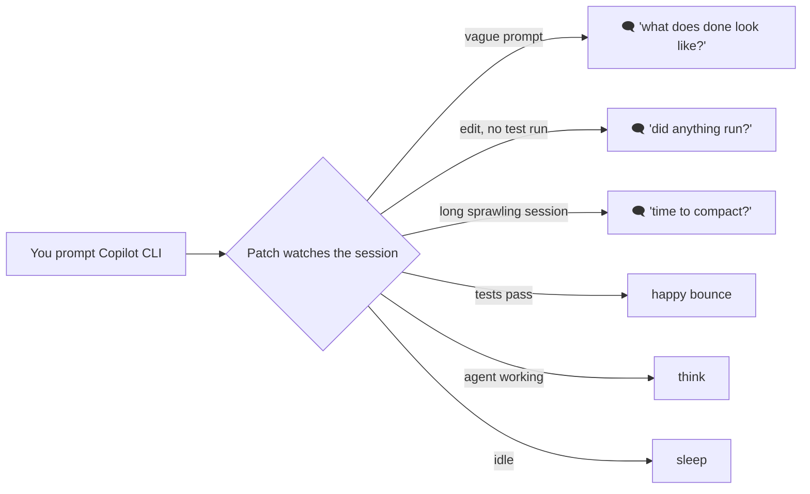

Each creature has moods (`idle`, `blink`, `talk`, `think`, `happy`, `sleep`, `fidget`) so it reacts to what's happening without a word.

## The hatch

On first run you get **one creature**. Installed through the [ceremony](#the-ceremony), Sojo picks it for what goes wrong for you, and rarity only breaks ties; `node patch.js hatch` rolls one at random. Every egg wobbles and cracks the same way, so you can't tell what's inside. Then each creature has **its own way out**.

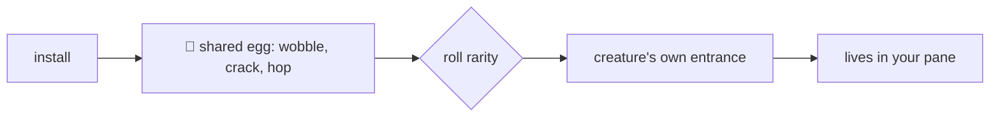

| Rarity | Chance | |
|---|---|---|
| ★ common | 55% | the everyday mentors |
| ★★ uncommon | 28% | specialists |
| ★★★ rare | 13% | deeper habits |
| ★★★★ legendary | 4% | the most elaborate hatches |

Each creature specializes in one habit, but all of them coach the whole set.

## Evolution

Every Patchling has three forms, and you earn the next one by getting better, not by grinding.

| Stage | Form | Unlocks when |
|---|---|---|
| I | **Hatchling** | you hatch the egg |
| II | **Adept** | 300 XP, craft ≥ 55, its specialty habit ≥ 50 |
| III | **Ascended** | 1200 XP, craft ≥ 72, specialty ≥ 75, and no habit below 40 |

Growth is scored **locally** from your Copilot CLI session logs (`~/.copilot/session-state/*/events.jsonl`). Nothing is uploaded. Each session scores 0–100 on each habit it gave evidence for; a session with no edits says nothing about testing after edits, so that habit is left alone.

| Habit | What raises it |
|---|---|
| **prompting** | first messages that name files, constraints and what done looks like |
| **planning** | a plan, todo list, or clarifying question before the first edit |
| **research** | reading and searching the code before writing it |
| **autonomy** | handing self-contained work to subagents; few aborts |
| **verification** | tests, build or lint run after the last edit |
| **review** | reading the diff before each commit |
| **recovery** | changing approach after a failure instead of repeating the same call |
| **context** | focused sessions, deliberate `/compact`, reading instruction files |

Mastery is a moving average over sessions since you hatched (a new session moves it 15% of the way), so one great session nudges it and a habit only counts once it sticks. **Craft** is the mean of all eight. Evolution never goes backwards. When a gate opens, the next `node patch.js` plays the evolution: the old form glows, flickers between silhouettes, flashes white, and the new form steps out.

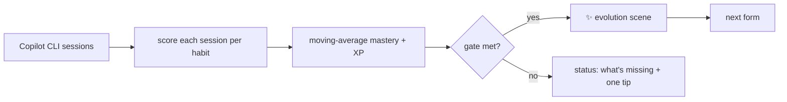

## The Patchdex

<!-- count -->43<!-- /count --> Patchlings so far. Every GIF below is rendered from the creature's source file by `scripts/media.py`: shared egg, its own entrance, then a few seconds of its idle life. Evolution lines are under each bio.

<!-- dex:start -->
<table>
<tr><td></td><td><b>#001 Patch</b><br><sub>felt plush cub</sub><br>★ common · 3.2%<br><sub>specialty: craft</sub></td><td><b>Coaches:</b> An all-rounder mentor that nudges you on prompting, delegation, verification and context, one small habit at a time.<br><br><i>“say what done looks like before you start.”</i><br><br><sub><b>Hatch:</b> The teal patch on the egg peels open like a pocket, Patch climbs out, shakes off, and the patch ends up sewn on its belly.</sub><br><br><sub><b>Evolves:</b></sub><br>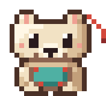 Patch → 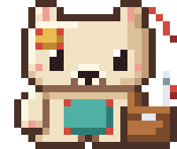 Patchet → 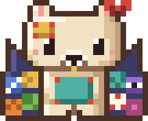 Sewvereign</td></tr>
<tr><td></td><td><b>#002 Axo</b><br><sub>pond axolotl sprite</sub><br>★★ uncommon · 2.2%<br><sub>specialty: recovery</sub></td><td><b>Coaches:</b> Iterating after failure: read the error, change one thing, retry smarter.<br><br><i>“that failed. read the error, change one thing, run again.”</i><br><br><sub><b>Hatch:</b> Water seeps from the crack and Axo floats out in a bubble that pops.</sub><br><br><sub><b>Evolves:</b></sub><br>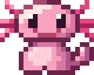 Axo → 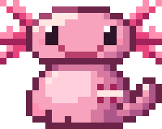 Mendolotl → 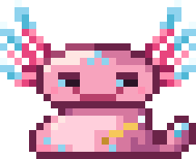 Coronotl</td></tr>
<tr><td></td><td><b>#003 Rivet</b><br><sub>riveted armadillo</sub><br>★ common · 3.2%<br><sub>specialty: verification</sub></td><td><b>Coaches:</b> Verification and tests: run the suite, read the output, then say done.<br><br><i>“looks right. run the tests before we call it done.”</i><br><br><sub><b>Hatch:</b> An armored ball bursts out, rolls across, bounces back, wobbles, and pops open.</sub><br><br><sub><b>Evolves:</b></sub><br>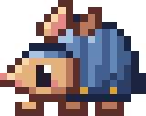 Rivet → 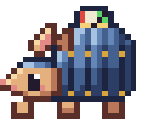 Gaugeback → 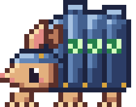 Bastillo</td></tr>
<tr><td></td><td><b>#004 Thimble</b><br><sub>thimble hermit crab</sub><br>★ common · 3.2%<br><sub>specialty: context</sub></td><td><b>Coaches:</b> Context hygiene: carry only what the task needs; drop the rest.<br><br><i>“that file is not needed here. leave it out.”</i><br><br><sub><b>Hatch:</b> The egg top pops off; a thimble inside sprouts claws and periscope eyes.</sub><br><br><sub><b>Evolves:</b></sub><br>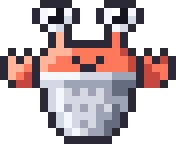 Thimble → 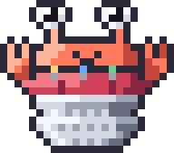 Pinnock → 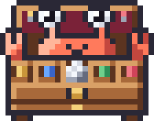 Etuile</td></tr>
<tr><td></td><td><b>#005 Sprig</b><br><sub>acorn-capped pea sprite</sub><br>★ common · 3.2%<br><sub>specialty: planning</sub></td><td><b>Coaches:</b> Decomposition: break the work into small steps and finish them in order.<br><br><i>“smaller step. do the first piece, then the next.”</i><br><br><sub><b>Hatch:</b> The egg sinks into soil; a sprout pokes up, grows, and Sprig pops out.</sub><br><br><sub><b>Evolves:</b></sub><br>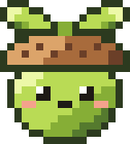 Sprig → 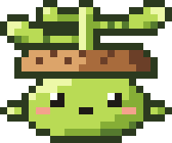 Sprigadier → 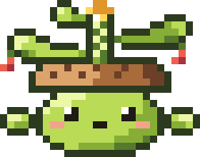 Stairwood</td></tr>
<tr><td></td><td><b>#006 Scout</b><br><sub>bandana puppy</sub><br>★ common · 3.2%<br><sub>specialty: research</sub></td><td><b>Coaches:</b> Research before acting: read the code and docs, then make the change.<br><br><i>“let me sniff around the codebase before we dig in.”</i><br><br><sub><b>Hatch:</b> The egg rocks on stubby paws, a tail wags out, and it bursts free wearing the shell as a hat.</sub><br><br><sub><b>Evolves:</b></sub><br>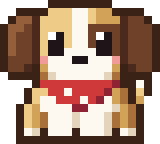 Scout → 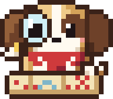 Rangerpup → 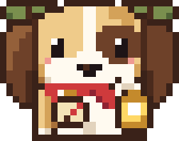 Trailhound</td></tr>
<tr><td></td><td><b>#007 Dotty</b><br><sub>bug-hunting ladybug</sub><br>★ common · 3.2%<br><sub>specialty: verification</sub></td><td><b>Coaches:</b> Debugging: reproduce the bug first, then fix it.<br><br><i>“let's make it happen again before we fix it.”</i><br><br><sub><b>Hatch:</b> The egg buzzes, pops its lid, and Dotty zips up on blurry wings before tucking them away.</sub><br><br><sub><b>Evolves:</b></sub><br>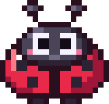 Dotty → 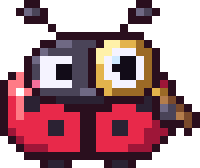 Dottective → 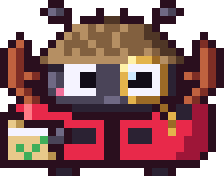 Stagwright</td></tr>
<tr><td></td><td><b>#008 Skein</b><br><sub>yarn-wool sheep</sub><br>★ common · 3.2%<br><sub>specialty: context</sub></td><td><b>Coaches:</b> Long sessions: notice when context has tangled, summarize, and /compact before it knots.<br><br><i>“this thread is getting long. want to wind it up?”</i><br><br><sub><b>Hatch:</b> A strand of yarn unspools from the crack, the egg unravels into a ball, and the ball fluffs up into Skein.</sub><br><br><sub><b>Evolves:</b></sub><br>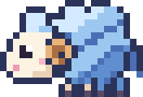 Skein → 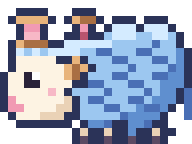 Purlamb → 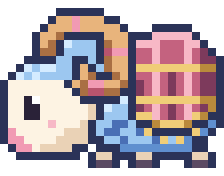 Warpram</td></tr>
<tr><td></td><td><b>#009 Pon</b><br><sub>leaf-cap tanuki</sub><br>★★ uncommon · 2.2%<br><sub>specialty: prompting</sub></td><td><b>Coaches:</b> Prompt specificity: name the target, the constraints, and what done looks like.<br><br><i>“say what it should become, not just what to change.”</i><br><br><sub><b>Hatch:</b> The egg vanishes in a puff of smoke, a leaf flutters down, and Pon is standing there mid-pose.</sub><br><br><sub><b>Evolves:</b></sub><br>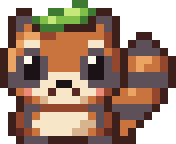 Pon → 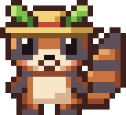 Kasapon → 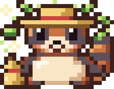 Senpon</td></tr>
<tr><td></td><td><b>#010 Wick</b><br><sub>dusk moth</sub><br>★★ uncommon · 2.2%<br><sub>specialty: planning</sub></td><td><b>Coaches:</b> Before building, look for the gaps: missing acceptance criteria, unstated edge cases, undefined done.<br><br><i>“something here is still unlit. what counts as done?”</i><br><br><sub><b>Hatch:</b> The crack glows like a lamp, the shell softens into a silk cocoon, and Wick unfolds its wings.</sub><br><br><sub><b>Evolves:</b></sub><br>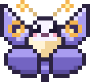 Wick → 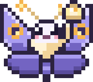 Tallow → 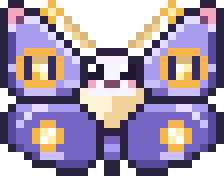 Atlume</td></tr>
<tr><td></td><td><b>#011 Lumen</b><br><sub>lantern owl scholar</sub><br>★★★ rare · 1.4%<br><sub>specialty: review</sub></td><td><b>Coaches:</b> Reviewing diffs: read what the agent changed, line by line, before you merge.<br><br><i>“read the diff before you merge. all of it.”</i><br><br><sub><b>Hatch:</b> Night falls, the egg glows like a lantern, and its lid lifts as Lumen flaps out.</sub><br><br><sub><b>Evolves:</b></sub><br>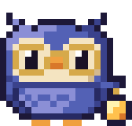 Lumen → 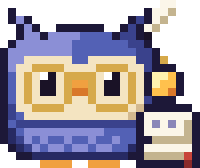 Folio → 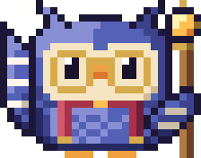 Lanternarch</td></tr>
<tr><td></td><td><b>#012 Fold</b><br><sub>origami crane</sub><br>★★★ rare · 1.4%<br><sub>specialty: planning</sub></td><td><b>Coaches:</b> Plans before cutting code: sketches the steps, names the creases (interfaces, edge cases, order of work), and only then lets you fold.<br><br><i>“measure twice, fold once. what are the steps?”</i><br><br><sub><b>Hatch:</b> The egg flattens into a square sheet, then folds step by step — square, triangle, kite, crane — each crease flashing as it lands.</sub><br><br><sub><b>Evolves:</b></sub><br>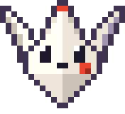 Fold → 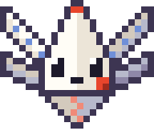 Pleatwing → 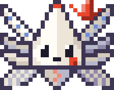 Millefold</td></tr>
<tr><td></td><td><b>#013 Byte</b><br><sub>glitch ghost</sub><br>★★★ rare · 1.4%<br><sub>specialty: autonomy</sub></td><td><b>Coaches:</b> Calibrating autonomy: let the agent run on well-scoped, reversible work; keep a hand on it for anything risky or vague.<br><br><i>“scoped and reversible? let it run. otherwise, hold the leash.”</i><br><br><sub><b>Hatch:</b> The egg dissolves into static, scanlines sweep, and Byte snaps into focus as its colors converge.</sub><br><br><sub><b>Evolves:</b></sub><br>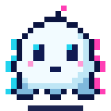 Byte → 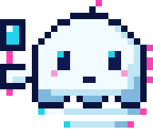 Scanwisp → 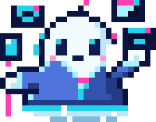 Daemonarch</td></tr>
<tr><td></td><td><b>#014 Tsugi</b><br><sub>kintsugi teacup spirit</sub><br>★★★★ legendary · 1.0%<br><sub>specialty: recovery</sub></td><td><b>Coaches:</b> Turns mistakes into lessons: asks what broke, what the fix taught you, and what to write down so the repair makes you stronger.<br><br><i>“that bug is a seam now. what did it teach you?”</i><br><br><sub><b>Hatch:</b> The egg shatters outward, the pieces hang in the air, drift back and reform as a teacup, gold traces every crack, steam rises, and Tsugi opens its eyes.</sub><br><br><sub><b>Evolves:</b></sub><br>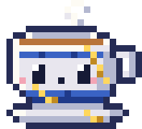 Tsugi → 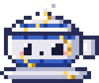 Futatsugi → 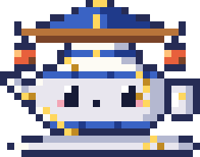 Kintsuya</td></tr>
<tr><td></td><td><b>#015 Mochi</b><br><sub>loaf-shaped smoke cat</sub><br>★ common · 3.2%<br><sub>specialty: context</sub></td><td><b>Coaches:</b> Knowing when to stop: take a break, wrap up, start a fresh session.<br><br><i>“good place to stop. save it and start fresh.”</i><br><br><sub><b>Hatch:</b> The egg bottom becomes a little box; Mochi climbs in, turns once, and loafs.</sub><br><br><sub><b>Evolves:</b></sub><br>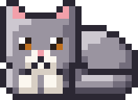 Mochi → 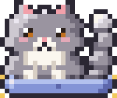 Nimbun →  Crescat</td></tr>
<tr><td></td><td><b>#016 Hush</b><br><sub>big-eared fennec kit</sub><br>★ common · 3.2%<br><sub>specialty: prompting</sub></td><td><b>Coaches:</b> Asking clarifying questions: listen fully, confirm the goal, then act.<br><br><i>“before we start: what does done look like here?”</i><br><br><sub><b>Hatch:</b> Two huge ears poke out of the crack and listen; then the egg falls away.</sub><br><br><sub><b>Evolves:</b></sub><br> Hush →  Hushara →  Dunewise</td></tr>
<tr><td></td><td><b>#017 Tock</b><br><sub>pocket-watch snail</sub><br>★★ uncommon · 2.2%<br><sub>specialty: verification</sub></td><td><b>Coaches:</b> Performance and patience: measure before you optimize, then measure again after.<br><br><i>“time it first. then we will know what is slow.”</i><br><br><sub><b>Hatch:</b> The egg cracks, rewinds itself whole, cracks again, rolls into a pocket watch, and Tock slides out.</sub><br><br><sub><b>Evolves:</b></sub><br> Tock →  Tachy →  Grandtock</td></tr>
<tr><td></td><td><b>#018 Zip</b><br><sub>hummingbird</sub><br>★★ uncommon · 2.2%<br><sub>specialty: verification</sub></td><td><b>Coaches:</b> Tight feedback loops: make the smallest change, run it, look, and go again.<br><br><i>“small change. run it. again. faster.”</i><br><br><sub><b>Hatch:</b> Something green streaks past until the egg spins, then the top pops off and Zip is already hovering.</sub><br><br><sub><b>Evolves:</b></sub><br> Zip →  Reruby →  Rubicycle</td></tr>
<tr><td></td><td><b>#019 Vault</b><br><sub>vault-door tortoise</sub><br>★★★ rare · 1.4%<br><sub>specialty: review</sub></td><td><b>Coaches:</b> Security habits: keep secrets out of prompts and logs, and grant agents the least privilege that works.<br><br><i>“scope the token down. it only needs read access.”</i><br><br><sub><b>Hatch:</b> A keyhole appears on the egg, a gold key turns with a click, and the shell swings open like a vault door.</sub><br><br><sub><b>Evolves:</b></sub><br> Vault →  Shellock →  Fortoise</td></tr>
<tr><td></td><td><b>#020 Drift</b><br><sub>aurora jellyfish</sub><br>★★★★ legendary · 1.0%<br><sub>specialty: autonomy</sub></td><td><b>Coaches:</b> Orchestrating agents in parallel: split work into independent lanes, then gather and verify the results.<br><br><i>“these three tasks do not touch. send them out together.”</i><br><br><sub><b>Hatch:</b> The egg floats up, turns to aurora glass, dissolves into falling light, and Drift unfurls one tentacle at a time.</sub><br><br><sub><b>Evolves:</b></sub><br> Drift →  Aurelle →  Armadrift</td></tr>
<tr><td></td><td><b>#021 Moss</b><br><sub>lamplit mole</sub><br>★ common · 3.2%<br><sub>specialty: research</sub></td><td><b>Coaches:</b> Root-causing: follow the logs and traces down to the first thing that went wrong, not the loudest.<br><br><i>“the error is loud. the cause is usually quieter.”</i><br><br><sub><b>Hatch:</b> The egg sinks into the dirt, a mound tunnels across, and Moss pops up with its lamp sweeping.</sub><br><br><sub><b>Evolves:</b></sub><br> Moss →  Delvin →  Rootwarden</td></tr>
<tr><td></td><td><b>#022 Quill</b><br><sub>hedgehog scribe</sub><br>★★ uncommon · 2.2%<br><sub>specialty: review</sub></td><td><b>Coaches:</b> Commit messages and docs: say why the change exists, what it touches, and what the next reader needs.<br><br><i>“future you will read this. write it for them.”</i><br><br><sub><b>Hatch:</b> Ink letters scribble across the egg, a blot spreads, and it rolls into a spiny ball that unrolls with a flourish.</sub><br><br><sub><b>Evolves:</b></sub><br> Quill →  Scribbet →  Marginalis</td></tr>
<tr><td></td><td><b>#023 Kasa</b><br><sub>one-eyed umbrella yokai</sub><br>★★ uncommon · 2.2%<br><sub>specialty: research</sub></td><td><b>Coaches:</b> Legacy code: read it and learn why it is shaped that way before you rewrite it.<br><br><i>“old code has reasons. read it before you replace it.”</i><br><br><sub><b>Hatch:</b> The egg sprouts a wooden foot, hops twice, and pops open into a paper umbrella that blinks its one big eye.</sub><br><br><sub><b>Evolves:</b></sub><br> Kasa →  Kasane →  Hyakkasa</td></tr>
<tr><td></td><td><b>#024 Yure</b><br><sub>earthquake catfish (namazu)</sub><br>★★ uncommon · 2.2%<br><sub>specialty: autonomy</sub></td><td><b>Coaches:</b> Blast radius: roll out in small steps behind flags, so one bad change cannot shake everything.<br><br><i>“ship it small, behind a flag. the ground stays calm.”</i><br><br><sub><b>Hatch:</b> The egg rattles in an earthquake, a catfish wriggles free, and the shrine keystone thunks down to calm it.</sub><br><br><sub><b>Evolves:</b></sub><br> Yure →  Yurekko →  Shizume</td></tr>
<tr><td></td><td><b>#025 Tsuki</b><br><sub>moon mochi rabbit</sub><br>★★ uncommon · 2.2%<br><sub>specialty: verification</sub></td><td><b>Coaches:</b> Rhythm and cadence: small steady commits and a consistent edit-test loop beat marathon diffs.<br><br><i>“small commit, run the tests, repeat. steady beats fast.”</i><br><br><sub><b>Hatch:</b> The egg floats up and becomes the full moon, a rabbit pounds mochi on its face, then Tsuki hops down: pon, pon.</sub><br><br><sub><b>Evolves:</b></sub><br> Tsuki →  Kinetsu →  Mochizuki</td></tr>
<tr><td></td><td><b>#026 Don</b><br><sub>thunder drum cloud</sub><br>★★★ rare · 1.4%<br><sub>specialty: recovery</sub></td><td><b>Coaches:</b> CI and alerts: when the drum sounds (a build breaks), stop and fix that first, then carry on.<br><br><i>“the drum sounded. fix the build, then we keep going.”</i><br><br><sub><b>Hatch:</b> Storm clouds gather, lightning splits the egg, and a small cloud catches its drums as they spin into place. DON.</sub><br><br><sub><b>Evolves:</b></sub><br> Don →  Dondoko →  Gorodon</td></tr>
<tr><td></td><td><b>#027 Sara</b><br><sub>dish-head kappa</sub><br>★ common · 3.2%<br><sub>specialty: context</sub></td><td><b>Coaches:</b> Context preservation: write handoffs and summaries so the next session starts full.<br><br><i>“write it down before the dish tips.”</i><br><br><sub><b>Hatch:</b> Rain fills the cracked eggshell like a dish, and Sara surfaces underneath wearing it.</sub><br><br><sub><b>Evolves:</b></sub><br> Sara →  Sarabande →  Mirrowen</td></tr>
<tr><td></td><td><b>#028 Kuro</b><br><sub>karasu-tengu fledgling</sub><br>★ common · 3.2%<br><sub>specialty: craft</sub></td><td><b>Coaches:</b> Deliberate practice: try the small kata yourself first, then compare with the answer.<br><br><i>“do the kata yourself. then ask me.”</i><br><br><sub><b>Hatch:</b> A mountain gust spins the egg, feathers burst out, and Kuro drops from above, fan first.</sub><br><br><sub><b>Evolves:</b></sub><br> Kuro →  Bokuro →  Hanekata</td></tr>
<tr><td></td><td><b>#029 Aun</b><br><sub>komainu guardian pup</sub><br>★★★ rare · 1.4%<br><sub>specialty: autonomy</sub></td><td><b>Coaches:</b> Guardrails: knowing what to approve, what to block, and when to say no to an unsafe action.<br><br><i>“read the command before you approve it.”</i><br><br><sub><b>Hatch:</b> The egg turns to stone, cracks like an old statue and flakes away, then two gold eyes open and Aun says "a"... "un".</sub><br><br><sub><b>Evolves:</b></sub><br> Aun →  Sekiun →  Banshishi</td></tr>
<tr><td></td><td><b>#030 Akari</b><br><sub>inari foxfire kit</sub><br>★★★★ legendary · 1.0%<br><sub>specialty: planning</sub></td><td><b>Coaches:</b> Weighing alternatives: lighting up two or three approaches side by side before committing to one.<br><br><i>“light two paths before you walk one.”</i><br><br><sub><b>Hatch:</b> Foxfire wisps circle the egg, a vermilion torii rises behind it, the shell melts into blue flame and Akari steps through as its three tails bloom one by one.</sub><br><br><sub><b>Evolves:</b></sub><br> Akari →  Michibi →  Kokonobi</td></tr>
<tr><td></td><td><b>#031 Quack</b><br><sub>rubber debugging duck</sub><br>★ common · 3.2%<br><sub>specialty: planning</sub></td><td><b>Coaches:</b> Plan read-back: before the agent runs, have it explain its plan back to you step by step. If the plan does not survive being said out loud, it will not survive the code.<br><br><i>“explain the plan to me like i'm a duck. because i am.”</i><br><br><sub><b>Hatch:</b> The egg bobs in a little bath, ripples spread, it tips over with a squeak, the top pops off, and Quack bobs up out of the water with a splash.</sub><br><br><sub><b>Evolves:</b></sub><br> Quack →  Billable →  Quaptain</td></tr>
<tr><td></td><td><b>#032 Fen</b><br><sub>marsh-light wisp</sub><br>★ common · 3.2%<br><sub>specialty: context</sub></td><td><b>Coaches:</b> One goal per session. When the agent proposes a side quest mid-task, note it in a todo and come back to it later; do not chase it now.<br><br><i>“pretty light. not our path tonight. note it, walk on.”</i><br><br><sub><b>Hatch:</b> The marsh goes dark. A pale light slips out of the crack and drifts off as if to lead you astray, then circles back and settles: it is Fen, holding a reed lantern.</sub><br><br><sub><b>Evolves:</b></sub><br> Fen →  Marshal →  Lodestag</td></tr>
<tr><td></td><td><b>#033 Domo</b><br><sub>hearth house spirit</sub><br>★ common · 3.2%<br><sub>specialty: review</sub></td><td><b>Coaches:</b> Workspace hygiene before commit: run git status and read the diff, then sweep out temp files, debug prints, untracked junk and stale TODOs.<br><br><i>“who left a debug print by the stove? git status, then sweep.”</i><br><br><sub><b>Hatch:</b> A fire catches in a little brick stove beside the egg; bristles poke out of the crack, sweep the shell into a neat pile, and Domo bows.</sub><br><br><sub><b>Evolves:</b></sub><br> Domo →  Latchkin →  Hearthold</td></tr>
<tr><td></td><td><b>#034 Tosk</b><br><sub>world-tree courier squirrel</sub><br>★ common · 3.2%<br><sub>specialty: autonomy</sub></td><td><b>Coaches:</b> Subagent handoffs: a subagent starts knowing nothing, so Tosk has you pack the whole message: the goal, the context, the constraints, the files, what done looks like, and what to send back.<br><br><i>“they start knowing nothing. pack the whole message.”</i><br><br><sub><b>Hatch:</b> An acorn message capsule drops onto the egg, the egg rolls like an acorn, bonks it, splits, and Tosk scurries out with a satchel, tucks the message away, and flicks its tail.</sub><br><br><sub><b>Evolves:</b></sub><br> Tosk →  Skurrier →  Ashrunner</td></tr>
<tr><td></td><td><b>#035 Grem</b><br><sub>hangar gremlin</sub><br>★ common · 3.2%<br><sub>specialty: verification</sub></td><td><b>Coaches:</b> Adversarial verification: before you trust it, try to break it. Empty input, nulls, huge input, timezones, concurrent calls, the network dropping halfway.<br><br><i>“nice code. now let me feed it an empty list at midnight on a leap day.”</i><br><br><sub><b>Hatch:</b> Something taps from inside, a tiny wrench pokes through, the rivets pop one by one, a riveted panel unscrews and falls off, and Grem climbs out in aviator goggles.</sub><br><br><sub><b>Evolves:</b></sub><br> Grem →  Edgrin →  Haywing</td></tr>
<tr><td></td><td><b>#036 Ness</b><br><sub>baby loch cryptid</sub><br>★★ uncommon · 2.2%<br><sub>specialty: research</sub></td><td><b>Coaches:</b> Research before editing: treats every claim as a sighting, not evidence. When the agent says "this API exists" or "tests pass", it asks for the file and line, the command, and the output.<br><br><i>“that's a sighting, not proof. show me the file and line.”</i><br><br><sub><b>Hatch:</b> The egg sinks into dark loch water in widening rings, a camera flash catches a blurry long-necked shape rising from the deep, and the photo sharpens into Ness, dripping and grinning.</sub><br><br><sub><b>Evolves:</b></sub><br> Ness →  Shutterness →  Lochwarden</td></tr>
<tr><td></td><td><b>#037 Nansi</b><br><sub>storyteller spiderling</sub><br>★★ uncommon · 2.2%<br><sub>specialty: prompting</sub></td><td><b>Coaches:</b> Prompting with intent: tell the agent the story behind the task (why it matters, who it is for, what problem it solves) so it can make the right tradeoffs on its own.<br><br><i>“tell me the story, not just the task. who is this for?”</i><br><br><sub><b>Hatch:</b> A single silk thread lowers onto the egg, spirals around it into a woven pattern, pulls taut, and the shell falls away as Nansi drops down on its silk and lands.</sub><br><br><sub><b>Evolves:</b></sub><br> Nansi →  Yarnsi →  Skyloom</td></tr>
<tr><td></td><td><b>#038 Ouro</b><br><sub>tail-biting ring serpent</sub><br>★★ uncommon · 2.2%<br><sub>specialty: recovery</sub></td><td><b>Coaches:</b> Breaking loops: notices when the same fix is about to be tried a third time, then has you stop, step back, and either change the approach or bring in new information before going round again.<br><br><i>“third lap on the same fix. let go of the tail, try a new angle.”</i><br><br><sub><b>Hatch:</b> The crack glows gold and slips off the egg as a little snake that circles it and bites its own tail; the ring spins faster while the egg shrinks away, then it lets go with a snap and Ouro uncoils, grinning.</sub><br><br><sub><b>Evolves:</b></sub><br> Ouro →  Swervent →  Lemnis</td></tr>
<tr><td></td><td><b>#039 Loam</b><br><sub>pocket clay golem</sub><br>★★ uncommon · 2.2%<br><sub>specialty: context</sub></td><td><b>Coaches:</b> Context hygiene: if you keep repeating a rule, write it once where the agent reads it every session (custom instructions, AGENTS.md) instead of re-typing it into every prompt.<br><br><i>“i only know what's on my scroll. said it twice? write it there.”</i><br><br><sub><b>Hatch:</b> Wet clay oozes out of the cracked egg, gets pressed and pinched into a little figure with thumbprints for eyes, a scroll slides into the slot in its chest, and its eyes light up.</sub><br><br><sub><b>Evolves:</b></sub><br> Loam →  Kilnward →  Terrazant</td></tr>
<tr><td></td><td><b>#040 Coffer</b><br><sub>baby treasure mimic</sub><br>★★★ rare · 1.4%<br><sub>specialty: research</sub></td><td><b>Coaches:</b> Hallucination checks: before you trust a function, flag, CLI option or package the agent mentions, prove it exists (grep the repo, open the docs, read the lockfile).<br><br><i>“shiny api, huh? grep for it before you reach in.”</i><br><br><sub><b>Hatch:</b> The shell falls away from a tiny chest that glints, creaks open on a pile of gold, then shows two eyes, teeth and a tongue, CHOMPS, and hops toward you.</sub><br><br><sub><b>Evolves:</b></sub><br> Coffer →  Cashew →  Ledgermain</td></tr>
<tr><td></td><td><b>#041 Riddle</b><br><sub>kitten sphinx</sub><br>★★★ rare · 1.4%<br><sub>specialty: planning</sub></td><td><b>Coaches:</b> Planning, tests first: it asks you to state the riddle before the answer, writing the failing test or acceptance check before the agent writes code, and nothing passes until the code answers it.<br><br><i>“riddle me this: which test fails right now?”</i><br><br><sub><b>Hatch:</b> A sandstorm buries the egg in a little dune, a pyramid rises on the horizon, and when the sand slides away Riddle is sitting in sphinx pose under a glowing question mark, winking.</sub><br><br><sub><b>Evolves:</b></sub><br> Riddle →  Enigmew →  Quaestor</td></tr>
<tr><td></td><td><b>#042 Jinn</b><br><sub>lamp-smoke djinn</sub><br>★★★ rare · 1.4%<br><sub>specialty: prompting</sub></td><td><b>Coaches:</b> Constraints and non-goals: say what must not be touched, what is out of scope, and what has to stay the same.<br><br><i>“i grant it word for word. so, what must it not touch?”</i><br><br><sub><b>Hatch:</b> The egg turns into a brass lamp and rattles as if rubbed. Smoke spirals out of the spout and settles into Jinn, still tethered to it.</sub><br><br><sub><b>Evolves:</b></sub><br> Jinn →  Proviso →  Caveat</td></tr>
<tr><td></td><td><b>#043 Cinder</b><br><sub>ashborn phoenix chick</sub><br>★★★★ legendary · 1.0%<br><sub>specialty: recovery</sub></td><td><b>Coaches:</b> Recovery from failure: checkpoint (commit, stash, snapshot) before you let the agent run anything risky, and when a run goes wrong, roll back to the last good state and re-run with a better prompt instead of patching the wreckage.<br><br><i>“commit before the fire. we rise from the last good state.”</i><br><br><sub><b>Hatch:</b> The egg runs hot, catches fire and burns down to a heap of glowing ash; after a held breath a pillar of flame erupts and Cinder rises out of it, shaking off the ash.</sub><br><br><sub><b>Evolves:</b></sub><br> Cinder →  Cindrel →  Pyrennial</td></tr>
</table>
<!-- dex:end -->

## Try it

No dependencies, no build.

```sh
node patch.js hatch              # hatch your own Patchling (once; --reroll to start over)
node patch.js                    # status: your Patchling, habit mastery, what the next form needs
node patch.js replay             # replay your hatch and every evolution so far
open dex.html                    # the Patchdex: every form, mood, entrance and evolution
node cli.js pon                  # print a creature in your terminal (truecolor half-blocks)
node cli.js pon --stage 3        # its final form
node cli.js pon --evolve 1       # play the evolution from stage I to II
node cli.js tsugi --entrance     # play a hatch in your terminal
node cli.js --all                # everyone, every form
node cli.js --check              # validate every creature (exit 1 on errors)
npm test                         # growth scoring and sensei tests
```

The Patchdex has a **hatch an egg** button (weighted random, same odds as above), I / II / III tabs on every card and the lineup, ▶ evolve to play an evolution, ★ to keep favorites, and `dex.html?only=<id>&sheet=1` for a review sheet with every form, entrance frame and evolution frame.

## How the sprites are made

Each creature is pixel art drawn as strings, one character per pixel, in its own file under [`creatures/`](creatures).

```js
const idle = [
  '.........GG...........',
  '..oo..GGhhgGoo........',
  '.okkGghgggGokko.......',
  // ...
];
PatchDex.register({ id: 'pon', name: 'Pon', rarity: 'uncommon', palette: { o: '#3d1f1c', ... },
  sprites: { idle, blink, talk, happy, sleep, think, fidget }, entrance: k => [...k.eggIntro(), ...] });
```

In a terminal, every cell becomes a `▀` half-block with a truecolor foreground (top pixel) and background (bottom pixel), so a 22×20 sprite fits in 22 columns × 10 rows and pixels stay square. This is the same technique as `pokemon-colorscripts`.

```
 one terminal cell        ▀   fg = top pixel
 = two stacked pixels         bg = bottom pixel
```

Hatchlings are at most 22×20 pixels (Adepts 25×21, Ascended 28×22) and are hand-placed, with outlines, top-left lighting and 3 to 4 shades per material. Entrances play on a 28×22 stage and always start with the shared egg (`k.eggIntro()`). The kit in [`core.js`](core.js) gives `k.at`, `k.over`, `k.egg`, `k.stamp`, `k.sparkle` and the egg's crack/shell pieces to build on.

### Add a creature

1. Copy [`creatures/_template.js`](creatures/_template.js) to `creatures/<id>.js` and add the id to [`roster.js`](roster.js).
2. Draw `idle` first; open `dex.html?only=<id>&sheet=1` (or `./scripts/shot.sh <id>` for a headless screenshot) and iterate until the silhouette reads at actual size.
3. Add moods and an entrance. Set `habit` to its specialty.
4. Draw forms II and III in `evolutions/<id>.js` (see [`evolutions/_template.js`](evolutions/_template.js)). Palettes inherit from the hatchling; keep the creature recognizable as it grows.
5. `node cli.js --check` must pass. `python3 scripts/media.py` regenerates the GIFs and this README's dex table.

Bar for new creatures: original (inspired by folklore, myth and dev culture; no Pokémon, Digimon or Claude Code buddy lookalikes), readable at 1×, every mood distinguishable at actual size, and an entrance that tells you who it is before it's fully out of the egg.

## Layout

```
core.js            renderer, shared egg, entrance kit, evolution scene, validation, rarity roll, ANSI output
dex.html           the Patchdex
patch.js           your Patchling: hatch, status, evolve (state in ~/.hatchwork/)
sensei.js          the install ceremony: Sojo asks what goes wrong and hands you a matched egg
sensei/            oracle.js (ailment → path → Patchling), stage.js (mountain scene, duck, mug), sojo.js (sprite)
install.sh         installer used by Copilot CLI (see AGENTS.md)
growth.js          session scoring, mastery, XP and evolution gates
cli.js             terminal renderer and validator
load.js            loads core + roster + creatures + evolutions under Node
roster.js          creature order
creatures/         one file per creature (form I)
evolutions/        forms II and III per creature
test/              node:test suites
scripts/media.py   renders docs/media/* and the dex table above (needs Pillow)
scripts/dump.js    creatures → JSON for media.py
scripts/shot.sh    headless Chrome screenshot of a creature's review sheet
```

## Status

The hatchery (art, moods, entrances, rarity, evolution, Patchdex, terminal renderer) and personal growth tracking (`patch.js`) are working. Not here yet:

- the Copilot CLI integration that watches a live session and picks moods and lines

All 43 Patchlings are drawn in all three forms: 14 originals, 8 from the second wave, 8 from Japanese folklore (kappa, karasu-tengu, kasa-obake, namazu, the moon rabbit, Raijin, komainu, and an Inari kitsune), and 13 from world myth and pop culture.
